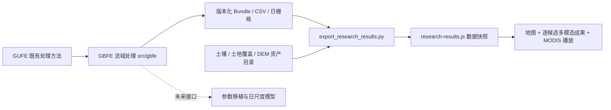

# HydroTransfer 代码框架与现有 GUFE 成果接入

当前采用已有的 GBFE 工程作为科学处理层；本界面通过只读适配器展示其已完成结果。没有重启原 GUFE、全量遥感或流量计算，也没有执行参数移植模型。

## 当前100项案例主入口

`global-results.js`读取`assets/optical-preview/`，按原GBFEID展示100项光学已完成案例、98个原生流域及分来源证据。`cube-viewer.js`读取`assets/cube-cohort/catalog.js`与按流域封装的JSON，关联全部8变量、7个土壤深度、五期土地覆盖及案例窗口内每日土壤湿度和流量。边界与河网共用原HYBAS_ID；输入与结果可以相互跳转，保留原GBFEID。每个输入包按SHA-256检查，切片按需读取。

原来的`research-results.js`与11项报告作为历史入口保留；五试点的完整每日时序继续独立按年加载。属性向量、参数移植与计算引擎保持待接入，不将GloFAS再分析切片或合成过程线称为模型运行结果。

以下图表说明原有11项报告的读取方式。

## 代码分工



| 层 | 当前实现 | 责任 |
|---|---|---|
| 科学处理 | `D:/projects/basin-flood-events/src/gbfe/` | 原生 HYBAS_ID、GBFEID、来源、文本、水文、SAR、MODIS、证据关联 |
| 读取与校验 | `scripts/export_research_results.py` | 跟随 latest_results.json；校验 Bundle SHA；读取输出；逐日面积与像元权重核对 |
| 数据契约 | `dist/assets/research-results.js` | 5 个流域、11 条来源候选、535 条证据；保留 null 和待采用状态 |
| 结果界面 | `dist/research-results.js` | 一次选择流域，展开来源候选、流量、遥感、时间线、证据表 |
| 地图与拓扑 | `dist/app-hydrobasins.js`、`dist/hydro-topology.js` | 全局 L8、试点入口、分区上下游关系 |
| 模型接口 | 后续模块 | 输入、参数、模型版本与计算结果；当前不提供真实模拟结果 |

## GitHub 项目

复用已有私有仓库：

- https://github.com/LENS-AI4S/basin-flood-events
- 当前流域分支：`feature/hydrobasins-l8-pilot`
- 本轮通过已配置的 Git 凭据只读核对远程引用，分支为 `ee127947adf3fe92d097bee83f68da6384d4bcbb`。

GitHub 连接器没有读到该私有仓库，浏览器匿名访问返回 404；上述远程引用核对成功。访问需使用有该仓库权限的 GitHub 账号。没有新建同名仓库，也没有将本次研究结果推送到 GitHub 科学代码仓库。

本次界面通过 HydroTransfer 站点与独立公开展示仓库 https://github.com/LENS-AI4S/hydrotransfer-demo 维护。科学代码、结果文件、界面展示三者通过版本与校验信息关联；结果不是跨来源去重后的正式事件库。

## 更新界面结果

```powershell
& 'D:/projects/basin-flood-events/.venv/Scripts/python.exe' `
  scripts/export_research_results.py --project 'D:/projects/basin-flood-events'
node pack-single.cjs
node scripts/check-research-results.cjs
```

适配器只读取已完成的 v2 成果。原始运行目录保持只读，导出过程不连接 GEE 或下载服务。

## MODIS 动态展示口径

逐日 `water_YYYYMMDD / observed_YYYYMMDD / clear_YYYYMMDD` 波段来自已有日栅格。候选水体只在当时选定的 `max_inundation` 足迹与有效观测内显示。面积采用原始像元面积及流域比例权重，逐日与原 CSV 比较，误差阈值 `1e-5 km²`。不插值或虚构缺测日期。

底图是同一事件固定的 MODIS SWIR/NIR/RED 假彩色参考影像，按固定的事件内 2–98 分位拉伸，仅用于展示。它不是逐日真彩色。蓝色是候选水体，灰色是当日缺测或固定参考影像无有效值；严格晴空比例单独显示。5 项证据不足的任务保留原对照图，没有补造动画。

## 科学状态

- 11 条是流域—来源候选，不是 11 次独立洪水。
- 文本匹配覆盖全部候选，但严格的证据采用规则尚未完成迁移；匹配与最终采用分开显示。
- 水文序列属于候选 GloFAS 格点。北京出口映射不代表所选完整流域，界面单独标注；其他出口也尚未独立接受。
- 6 项光学候选、5 项证据不足全部呈现；日期不相交照实标注。
- 土壤、DEM、土地覆盖是全球资产就绪状态，不表示已为每个选中流域完成模型输入提取。

## 只读数据立方体

已接入五个试点、7变量、7个土壤层；140张静态/五期土地覆盖预览，47,485张逐日土壤水分预览（2000–2025，共9,497天）。前端为 `dist/cube-viewer.js`，土地利用年轴与土壤水分日轴独立。生成器为 `scripts/build_cube_previews.py` 和 `scripts/build_moisture_all_years.py`；日数据按年度资源懒加载。NAS预览服务代码在 `services/`，当前未远程部署。完整数值数组保留私有目录，详见 [DATA_CUBE.md](DATA_CUBE.md)。
